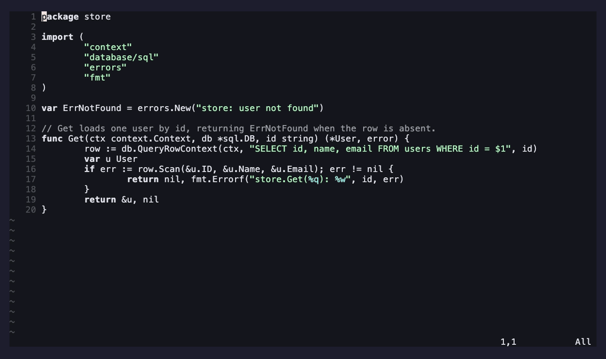

# ami-proactive.nvim

Proactive suggestions for [ami](https://github.com/moosch/ami.nvim), packaged as a
standalone **extension** — the reference example of an ami extension living in its
own repo.

When enabled, it asks ami's daemon for one brief, advice-only suggestion after the
editor has been idle for a while or just after a save. It's rate-limited, never
fires mid-typing, and drops the suggestion into the chat transcript (no stolen
focus) with a low-key notification — ignore it freely, or `:AmiChat` to respond.

It talks to ami only through the public extension API, so it's also a template for
writing your own: see ami's [`docs/extensions.md`](https://github.com/moosch/ami.nvim/blob/main/docs/extensions.md).

## Demo

`:AmiNudge` from a source file, then open the chat panel to watch the 💡 suggestion
land:



> Rendered from [`demos/proactive.tape`](demos/proactive.tape); see
> [`demos/README.md`](demos/README.md) to (re)generate it (needs ami-chat.nvim too).

## Requirements

- [ami.nvim](https://github.com/moosch/ami.nvim) (provides the extension API and
  the daemon's `/nudge` endpoint this extension calls).

## Install

With [lazy.nvim](https://github.com/folke/lazy.nvim), install it alongside ami and
register it in ami's `setup()`:

```lua
{
  "moosch/ami.nvim",
  dependencies = { "moosch/ami-proactive.nvim" },
  config = function()
    require("ami").setup({
      extensions = { require("ami-proactive") },
      -- enable it + tune (defaults shown):
      -- proactive = {
      --   enabled = false,
      --   on_idle = true, idle_ms = 20000,
      --   on_save = true,
      --   min_interval_s = 180,
      --   require_normal_mode = true,
      --   notify = true,
      -- },
    })
  end,
}
```

## Commands

| Command | What it does |
| --- | --- |
| `:AmiProactive` | Toggle proactive suggestions on/off at runtime |
| `:AmiNudge` | Request a suggestion right now (ignores the enable flag + rate limit) |

## Configuration

Config lives under `proactive` in ami's `setup()` (your values win over the
defaults above):

| Key | Default | Meaning |
| --- | --- | --- |
| `enabled` | `false` | master switch; off until you opt in |
| `on_idle` | `true` | suggest after `idle_ms` of inactivity |
| `idle_ms` | `20000` | idle threshold in milliseconds |
| `on_save` | `true` | suggest just after writing a buffer |
| `min_interval_s` | `180` | minimum seconds between suggestions (rate limit) |
| `require_normal_mode` | `true` | don't interrupt while you're in insert mode |
| `model` | `nil` | model for nudges; `nil` = ami's default (pick via `:AmiModel proactive`) |
| `add_to_chat` | `true` | append the full suggestion to the ami-chat transcript |
| `notify` | `true` | low-key `vim.notify` (one-line) when a suggestion arrives |
| `present` | `nil` | function to route the nudge anywhere; see below |

## Where nudges go

By default a suggestion is **appended to the ami-chat transcript** and a one-line
`vim.notify` is fired. (If you use [snacks.nvim](https://github.com/folke/snacks.nvim)
with its notifier enabled as your `vim.notify`, that one-liner already shows as a
snacks notification.)

To take full control of the notification, set `present` — a
`function(text, info)` that receives the full suggestion (`info.first_line` is a
short, truncated form). When set, it **replaces** the default `vim.notify` (the
transcript copy is still controlled by `add_to_chat`).

Route nudges to a snacks notification:

```lua
proactive = {
  enabled = true,
  add_to_chat = false,  -- optional: send only to snacks, skip the chat transcript
  present = function(text, info)
    require("snacks").notify(text, { title = "ami 💡 " .. info.first_line, level = "info" })
  end,
}
```

Or drop them into the snacks picker / a scratch buffer / anywhere — `present` just
hands you the text. A failing `present` is caught and logged, so a typo won't break
a chat turn.

## License

[MIT](LICENSE)
